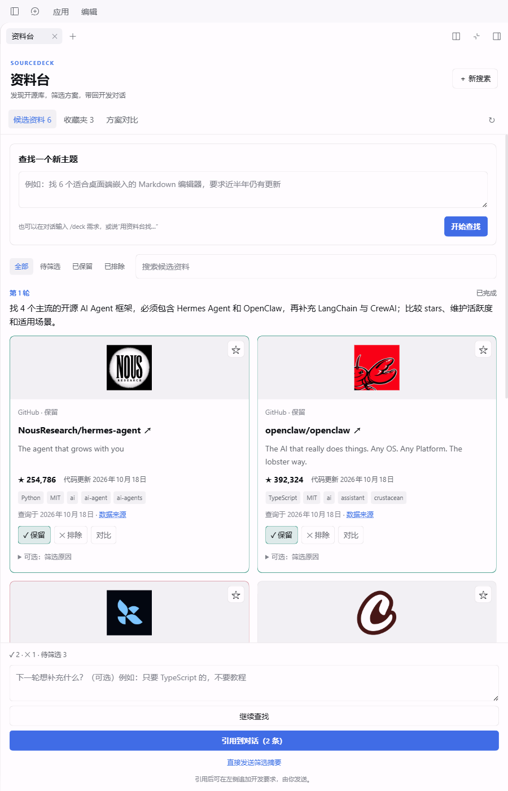
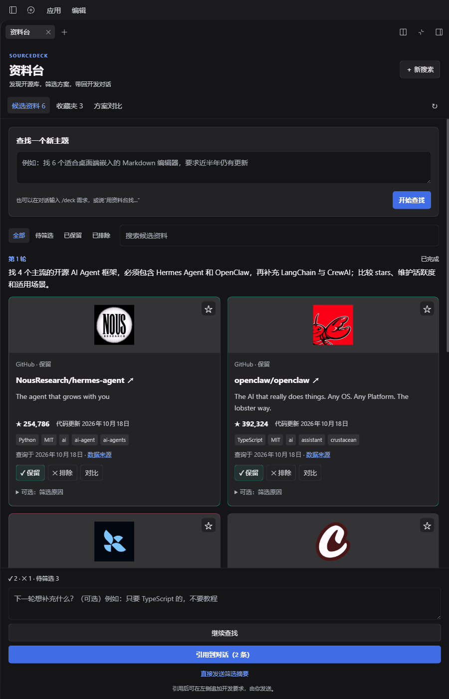
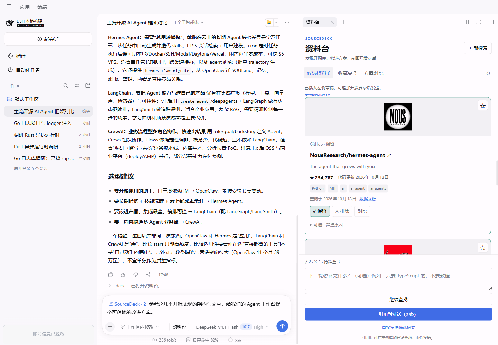
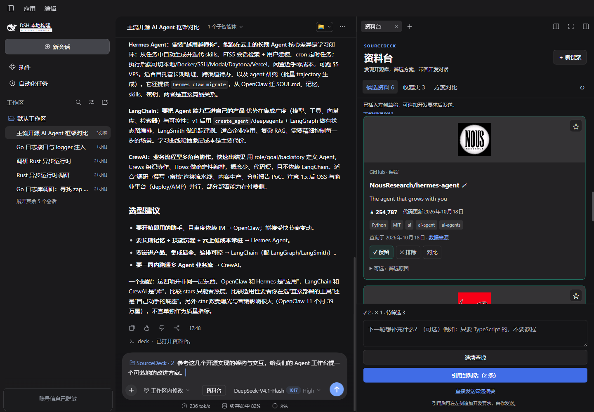

# SourceDeck

> [中文（默认）](README.md) | English

[GitHub](https://github.com/Archaofan/dsh-source-deck) · [0.3.2 preview](https://github.com/Archaofan/dsh-source-deck/releases/tag/v0.3.2) · [Stable 0.3.0](https://github.com/Archaofan/dsh-source-deck/releases/tag/v0.3.0) · [GitMCP](https://gitmcp.io/Archaofan/dsh-source-deck) · [Marketplace PR #7739](https://github.com/awesome-dsh-plugin/awesome-dsh-plugin/pull/7739)

SourceDeck is an open-source research workbench for DeepSeek Harness Desktop. It brings “let me see how others did it” out of a dozen browser tabs, scattered bookmarks, and chat history into one sidebar: background research, card-based screening, side-by-side comparison, and selected repositories referenced back into the current conversation.

## Why SourceDeck

Most product designs already have open-source implementations. Instead of reinventing the wheel, the usual move is to find a mature project, read its architecture, interactions, and tradeoffs, then decide whether to reuse it, borrow from it, or deliberately avoid it.

The hard part is rarely finding something. It is what happens after: how do you compare a dozen repositories quickly? Which ones did you review, and why did you reject them? How do you bring the selected ones back into the conversation so the Agent can continue against real code?

SourceDeck is built for that middle step. It turns a research pass into a traceable chain:

> state the need → background research → screen the cards → compare side by side → reference back into chat → keep building

Good for: technology selection, competitive or analogous project research, finding reusable implementations, and giving the Agent real background sources.  
Not for: replacing deep code audits or formal security/compliance review.

## Screenshots

Real Host screenshots (light / dark), using mainstream agent projects such as Hermes Agent and OpenClaw. Account information in the screenshots has been redacted.

| Light | Dark |
|---|---|
|  |  |

## Chat and deck work together

The deck is not a separate search page. It shares the same conversation context as the chat on the left, so research results, screening decisions, and references stay in one place.

1. **Start from chat**: type `/deck find a few mainstream agent frameworks...`, or simply say “use SourceDeck to find…”. The main Agent calls `deck_search` and starts an official managed child session; the main conversation stays usable.
2. **Results return to the same conversation**: candidates appear in the right-side deck, while the chat keeps a compact source card. “Open in deck” returns to the original topic. Internal search prompts stay in the child session and do not flood the main chat.
3. **Decide in the deck**: keep / exclude, write a reason, favorite, and compare up to four sources. Decisions are isolated per conversation/topic and never leak into another session.
4. **Reference back into chat**: click “Reference in chat”; kept sources enter the composer as an immutable snapshot. Existing draft text and attachments are preserved, and nothing is auto-sent. Then continue with “study these repositories and propose an improvement for our design”.
5. **Re-decisions do not rewrite inserted references**: later changes only affect future references. The inserted snapshot stays as it was and can be removed before sending.

The left side keeps the conversation going while the right-side deck stays in sync; the composer already holds a SourceDeck reference and a follow-up instruction:

| Light | Dark |
|---|---|
|  |  |

## Compatibility and installation

| Item | Exact version |
|---|---|
| SourceDeck | 0.3.2 |
| DeepSeek Harness Desktop | 0.2.1-rc.2 |
| @deepseek-ai/cordis | 4.0.5 |

Only public APIs from `0.2.1-rc.2` are used. **Only this RC baseline is maintained; fast-moving alpha builds are not supported.** Moving to a newer RC or a stable release requires a separate evaluation and acceptance pass.

Use the Desktop plugin manager to install `dsh-source-deck-0.3.2.tgz`, then restart when prompted. The list displays the bundled custom document icon and localized name. During development, use a new version or a content-hashed tgz path: the package manager may cache the same version at the same path.

Market submission [PR #7739](https://github.com/awesome-dsh-plugin/awesome-dsh-plugin/pull/7739) is still open, waiting for the automatic re-check and merge. Availability is not claimed yet. See [market status](docs/MARKETPLACE.md).

## Start from chat

- Say `Use SourceDeck to find a few mainstream agent frameworks and compare stars and maintenance`. The model starts research with `deck_search`; natural-language triggering depends on its tool choice.
- For a deterministic entry, use `/deck Find extensible open-source Markdown editors`. Arguments start research; bare `/deck` only opens the deck.
- The composer button, right-sidebar `+ → Deck`, and conversation cards also open it. Historical cards target their original topic.

Research runs in an official managed child session, inheriting the parent's model configuration and credential policy. It creates extra concurrent model requests. The Host samples recent parent messages as context. Internal search/follow-up prompts remain in the child; the parent can continue development, with concise command/tool status and source cards.

Workers may only use `web_search`, `web_fetch`, and `deck_submit_sources`. Official web tools and the spawn provider must be available. Startup failure is explicit; the plugin does not change configuration or upgrade the baseline.

## Screen and compare

0.3.2 focuses the result page: new-search and follow-up editors open on demand, candidate and favorite queries persist independently, and comparison restores return focus. Cards show saving status. References and direct summaries wait for pending screening writes; failed saves preserve drafts for retry. Full descriptions remain available in source details.

Full reads are serialized: approximately every two seconds during research and every thirty seconds for idle results. Periodic full reads pause in favorites or hidden panes and refresh on return. No service or dependency was added. Version 0.3.2 is a preview: actual 6/24/200-item lists, full-minute cadence and core tasks were checked; native Electron 125%, real IME, attachment combinations and human observation remain limited. See the [implementation record](docs/implementation/2026-10-19-experience-optimization.en.md) for methods and scope. Stable 0.3.0 remains available.

1. Cards show a project image/Logo, then try the GitHub owner avatar, then a monogram. GitHub stars, last code push, lookup time, and evidence link are separate. Unknown facts stay unknown; zero stars stay zero.
2. Keep or exclude; click the active verdict again to return to pending. Expand the optional reason. Favorites and comparison do not change verdicts.
3. Add up to four sources to the comparison panel for descriptions, stars, dates, languages, licenses, reasons, and URLs.
4. Cards default to two columns, automatically becoming one below 620px of panel content width. Light/dark modes follow the Host, including settings select options. Request/note/reason drafts and comparison choices are stored per session/topic in browser sessionStorage.
5. Open the follow-up editor to continue the same topic with current decisions and reasons. New search opens editing first; Start creates a new set. Cancelling preserves the draft and current results. Historical conversation cards reopen their original sets.
6. Screening, favorites, comparison, and references remain available during research. Stop affects only that worker. A five-minute timeout ends the task and keeps partial results. Unrestored work is marked interrupted after Host restart and can be retried.

## Reference and continue development

Press **Reference in chat (N sources)**. Existing draft text, attachments, and references remain; nothing is auto-sent. Append an instruction such as:

> Study the UI designs in these repositories, consider our existing components, then propose and implement improvements.

You can also type `@deck` in the composer and choose the current kept sources or a historical snapshot. References store an immutable snapshot of title, real URL, note, metadata, and screening reason; later verdict changes do not silently rewrite inserted sources. Click a reference to revisit its topic, or remove it before sending.

If the draft changes, the session switches, or the composer becomes unavailable during insertion, the original draft is preserved and a retry is offered. References invalidated by cleared data block sending until removed and reselected.

The secondary “Send screening summary” action delivers a summary immediately and makes the set read-only. Retries reuse the same request identity. Prefer references when you need to continue with a development instruction.

## Favorites and settings

The ☆ control saves a card to the profile-wide favorites library, with search, remove, and re-add. Favorites are shared across sessions and survive restarts.

The SourceDeck settings page offers optional GitHub / Web / LLM-freeform source policies and a clear-data action. Policies are hints and flags, not a guarantee that model results comply. Uninstalling does not automatically delete existing records.

## Data and limits

- The local `source_deck` domain keeps eight tables: sets, sources, candidates, selections, scope_policies, session_active, rounds, and favorites. Legacy records remain readable; search results stay bound to their topic and round.
- The plugin does not read credential files or store API keys. Search prompts and web requests go to providers under the Host configuration; external content is serialized as source data and never becomes user instructions.
- Images depend on the origin site, network, and Host CSP; failures do not affect screening or links. Metadata that the model did not verify should not be treated as real statistics.
- Concurrency is bounded by provider quota and official child-session settings. There is no cross-device sync, export, or version-chain diff.
- The real-Host acceptance scope and remaining gaps are documented in the [verification record](docs/SETUP-VERIFICATION.md).

## Contributing

SourceDeck is still early, and many tradeoffs are worth discussing together. Fork it, open an issue, or send a PR.

- **Found a problem**: open an issue with the DSH version, plugin version, reproduction steps, and relevant logs. Redact secrets first.
- **Want to change code**: fork, branch from `main`, keep the exact peers, run `node --test tests/*.test.ts` and `npm run build`, and explain the motivation, tradeoffs, and verification in the PR.
- **Want to add a source or scenario**: adapters and tests are welcome; please do not bring in alpha-only APIs.

You do not need to finish a whole feature. A clear scenario, one test, or one paragraph of documentation is a valuable contribution.

## Find the project

- GitHub: <https://github.com/Archaofan/dsh-source-deck> (searchable via `dsh-plugin`, `source-deck`, `DeepSeek Harness`)
- Latest release: <https://github.com/Archaofan/dsh-source-deck/releases/tag/v0.3.0>
- GitMCP documentation index: <https://gitmcp.io/Archaofan/dsh-source-deck>
- Plugin marketplace: awesome-dsh-plugin [PR #7739](https://github.com/awesome-dsh-plugin/awesome-dsh-plugin/pull/7739) (under review, not listed yet)

## Development

```sh
pnpm install
pnpm run build
node --test tests/*.test.ts
npm pack
```

Artifacts are the Host `lib/index.js`, Client lazy-CJS `lib/client.js`, types, icons, and Chinese/English locales. Exact peers stay unchanged; no dependencies were added.

- [v3 design](docs/superpowers/specs/2026-10-18-sourcedeck-v3-design.md)
- [Approved implementation plan](docs/superpowers/plans/2026-10-18-sourcedeck-v3.md)
- [Developer workflow research](docs/research/2026-10-18-developer-workflow-review.md)
- [Comparable tools, experience and performance](docs/research/2026-10-19-comparable-tools-experience-review.en.md) · [Iteration proposal (awaiting review)](docs/design/2026-10-19-experience-iteration-proposal.en.md)
- [Handoff](docs/HANDOFF.en.md) · [Version policy](docs/VERSION-POLICY.md)
