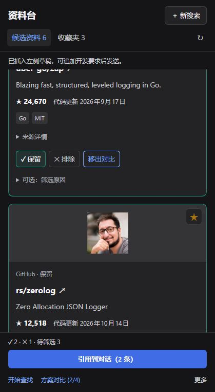

# 体验与性能优化实施记录（2026-10-19）

> 中文（默认） | [English](2026-10-19-experience-optimization.en.md)

用户已批准[迭代提案](../design/2026-10-19-experience-iteration-proposal.md)并要求落地；在当前会话执行[计划](../superpowers/plans/2026-10-19-experience-optimization.md)。0.4.0 条件范围未启动。

## 0.3.1 阶段

- 完整读取串行、写后合并补读、活动约 2 秒、终态 30 秒；使用固定 RC 的 `useTabInfo().tab.visible`，结合文档可见性/收藏模式暂停。打开意图观察器未停用。
- 最近一次新鲜响应文本相同则复用对象；仍然每次请求 Host，不跳过网络或使用过期结果。单次分组、收藏查找、Intl 复用及对比每项一次格式化；不改 Host/八表/依赖。
- 测试 75/75、构建通过。新增 scheduler、JSON 与 projection 测试均先失败再通过。
- 纯格式化探针（同机器/输入）200 次 p50/p95 为 0.456/0.495ms；原始基线为 18.080/20.661ms。这只衡量格式化，不是 Electron/UI/INP 提速。
- 0.3.1 tgz SHA256：`1774BE246AE262C2F185C61BB6DB94E9461DA965A3A9E6906220D7EEB0568BD8`。通过官方脚本安装；安装 lib/index.js、lib/client.js、package.json 哈希与构建相同。
- 受限环境 npm 默认缓存写入失败后改用命令级沙箱缓存；官方启动遇 userInfo 限制，仅为启动命令申请主机执行。基线未改，生产未动。
- 固定 RC 实际 loopback Host 已验证手动加入六个真实来源、复用既有 metadata、保留两项/排除一项及回读；无新研究模型调用。截图留在沙箱 experience-acceptance。
- 改动前结果态 2 个 textarea；候选查询 zap→收藏查询 zerolog→返回后候选查询变为 zerolog，已真实复现，作为 0.3.2 验证依据。完整读取频次、隐藏场景和最终布局矩阵留到最终验收记录，不提前宣称通过。

## 0.3.2 阶段与独立审查

- 结果态取消常驻需求/补搜文本框；新搜索、补充查找按需展开。取消保留主题和输入。候选/收藏查询独立保存；筛选空态有清除入口；对比保留列表 DOM、滚动位置并恢复按钮焦点。
- 卡片保留图、stars、代码推送时间、语言/许可证、直接判定和可选原因；完整说明与主题标签放入来源详情。保留/排除串行落库，待执行的显式选择合并到最后一次；显示保存状态和失败原因。
- 全分支独立审查发现三项 Important：失败旧读取吞补读、普通资料长说明无法展开、引用/直接摘要越过未完成写入。另有 Minor：对比返回焦点指向已卸载按钮。因后者直接违反键盘连续操作承诺，按 Important 一并修复，无未处理审查项；不以第二轮审查代替回归。
- 四类问题均先复现失败再修复：专用回归 11/11，全套 `node --test tests/*.test.ts` **81/81**；`npm run build` 通过。仓库无 `npm test` 脚本，实际测试使用上述 Node 命令。
- 引用与直接摘要等待当前主题队列结束；交接期间禁止新增判定/原因，保存失败阻止交付且允许重试。队列及操作忙碌状态按 owner 隔离。

## 固定 RC 的实际 Host 验收

最终代码包通过官方脚本安装，`lib/index.js`、`lib/client.js`、`package.json` 与本地构建 SHA256 相同；最终构建没有临时 `[source-deck-qa]` 日志。以下均在隔离沙箱，未操作生产、升级基线或修改上游。

| 检查 | 实际结果 |
|---|---|
| 六条真实来源筛选 | 两保留、一排除；照片/项目图、stars/推送时间保留；既有 metadata 复用，无新增研究模型调用 |
| 查询作用域 | 候选 zap、收藏 zerolog、返回候选仍 zap |
| 筛选空态 | 显示 0/6 和独立“没有匹配”信息；清除恢复六条 |
| 新搜索 | 仅展开编辑；Escape 后六条结果及新需求草稿保留 |
| 对比 | 两项进入/返回；焦点准确回到“方案对比 (2/4)”；返回滚动已检查 |
| 原因与引用 | 原因失焦保存后插入两条引用，正文 `QA existing draft — keep this text.` 仍在输入框；没有点击发送或触发模型 |
| 420×800 收起结果态 | 面板 419×762；header 56.14、nav 44.69、footer 115.73px，合计 **28.42%**；0 textarea、无横向溢出 |
| 深/浅 × 320/420/640/900 | 实际面板宽 319/419/639/899px；窄栏一列，后两档双列；均无根横向溢出 |
| 普通与压力列表 | 产品界面逐项加入 24 条成功；后续实际确认至少 158 条已显示。批量继续受浏览器控制及自动审核超时影响，**200 条交互性能未通过验收** |

截图来自实际 Host，仅裁取插件面板，无账号区域。深色图是滚动阅读状态，浅色图是结果顶部。

| 浅色 | 深色 |
|---|---|
|  |  |

本地原始材料：共享沙箱 `test-workspaces/dsh-source-deck/experience-acceptance/`，不上传日志、bootstrap URL 或用户配置。诊断构建曾观测收藏页 47,051ms：完整读取 0、活动读取 24。静置旧样本实际只有 34,287ms（1 次完整读取、17 次活动读取），不能称为一分钟结果；60 秒 2 次、运行中 2 秒、暂停/恢复及不重叠由确定性 scheduler 回归验证。浏览器实际隐藏/完整分钟计数矩阵尚未完成，不将其写成已实测达标。

## 交付边界与后续验收

- 本次实现不改八表、Host/研究工具、引用协议、依赖或精确 RC peer；0.4.0 未实施。0.3.2 提供本地安装包与分支提交，未创建公开 Release 或安装生产。
- 常用流程通过，**100ms/500ms 用户延迟预算、200 条端到端交互、完整分钟/隐藏读取矩阵**仍需可靠控制端复核。批量自动化耗时含权限审核/工具开销，不能归因于 UI，也不能冒称 INP。
- Electron 原生 125%、真实中文 IME/附件组合、3–5 名真人任务研究尚未完成；已有附件/草稿的自动协议回归通过，不能替代上述人工验收。旧版的真实模型、取消、重启验证为既有证据，本轮未重新发起模型调用。
- 包路径、最终哈希、提交同步结果见 [验收记录](../SETUP-VERIFICATION.md)“2026-10-19 体验迭代”。
