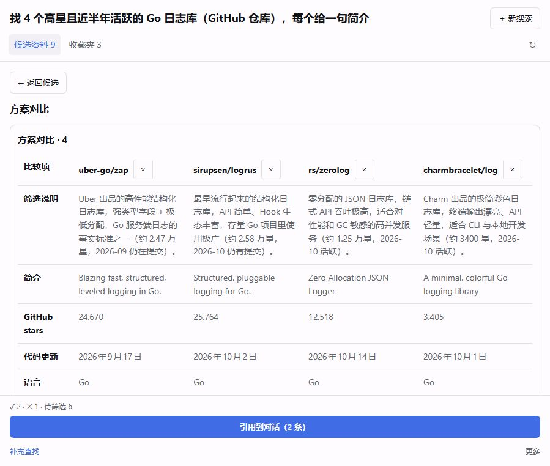

# 0.3.3：说明优先与窄栏对比

> 中文（默认） | [English](2026-10-20-screening-readability.en.md)

用户于 2026-10-20 确认简短设计，并授权自行验证、提交、推送和发布预发行版。本轮只调整既有筛选与对比呈现，不启动更大的研究平台或新数据架构。发布状态以[验收记录](../SETUP-VERIFICATION.md)末节为准。

## 变化

- 卡片优先显示已有 `note`，标为「筛选说明」。没有有效说明时回退到简介、摘录或缺失提示；不生成判断。详情保留完整说明、简介和不同的摘录，避免三行预览遮住正文。
- 对比把说明与简介分列为两个维度。资料台容器不足 620px 时逐维度纵向阅读，每个值显示来源名称；宽栏保留表格和内部滚动。仍最多四项，移除按钮带来源名称且至少 32×32px。
- 同一个表格适配两种宽度，保留原比较选择、查询、返回焦点和滚动逻辑。行列 scope/role 明确，窄栏左上角表头只做视觉裁切，不从可访问性树移除。
- 不改研究提示、模型调用、八表、引用协议、依赖或 lockfile；Host 端 index.js 字节与 0.3.2 相同。精确支持 DSH 0.2.1-rc.2、Cordis 4.0.5，生产未操作。

## 验证

新增两个实际组件渲染回归，先在旧实现失败：通用简介遮住筛选说明；对比缺少已有说明。实现后 83/83 全量测试通过，构建通过。另保留原全文 disclosure、引用/草稿、写入排序和主题隔离回归。npm 仍提示原有 auto-install-peers/resolution-mode 配置兼容性警告；没有新增依赖。

独立审查指出窄栏不能用 display:none 移除首列表头。修复为 1px 裁切后审查确认关闭。实际 Chromium Host 可访问性快照中保留「比较项」及四个来源列头、每行一个行头和四个值；这不是原生屏幕阅读器实际播报验收。

实际固定 RC Host（官方未打包开发模式）复用旧 Go 日志库研究结果，不重新请求模型；另手动加入一条长英文名称、无 URL/元数据的 QA 来源。额外安装插件只有 SourceDeck 0.3.3，官方内置插件保持原 profile。测试在项目专属共享沙箱中进行，原始矩阵位于 `test-workspaces/dsh-source-deck/layout-0.3.3.json`，不上传运行日志或认证 URL。

| 矩阵 | 实际资料台宽度 | 结果 |
|---|---|---|
| 深色中文、浅色英文，各四项 | 319 / 419px | 纵向维度，来源名可见；对比区和页面均无横向溢出 |
| 同上 | 639px | 表格，四项在对比区内横向滚动；页面不溢出 |
| 同上 | 899px | 表格，四项无需横向滚动 |

浏览器视口为 320/420/640/900×800 CSS px；Host 全屏面板边框导致实测少 1px。较宽视口可能恢复普通窄侧栏，已显式使用 Host 全屏按钮验证实际容器宽度，未把视口当成面板。

实际场景还覆盖：中英混合说明与简介同时可读；长英文连续名称换行；未知 stars/日期为 Unknown、其他缺项为破折号；Enter 移除四项中的一项；返回焦点恢复至当前三项对比按钮；查询 zap 在进入/返回对比后保留；两项引用插入后保留 QA 正文和引用标记、没有自动发送。控制台 error 为 0。

| 窄栏浅色 | 窄栏深色 |
|---|---|
|  |  |

## 交付范围

包 `E:/DSH-Desktop-Plugin-Dev/dsh-source-deck/dsh-source-deck-0.3.3.tgz`，177295 bytes、53 文件，SHA256 `20E87669430F10052CCDBB9D41859352806BB739F7FC5F85FC9086AE0B61520C`。通过官方 Install-Plugin.ps1 使用哈希路径安装，lib/index.js、lib/client.js、package.json 和中英 README 与本地逐项匹配；不含 src/tests/docs/日志/缓存。lib/client.js SHA256 为 `82F0CF6434CB996CF8D86D7EB4DB9C5D5D2A64032F5C4903CA8139DF6E5EB5D6`。

本轮为预发行。原生 Electron 125%、真实中文 IME/附件组合、真人观察及原生屏幕阅读器仍未覆盖；未重跑 0.3.2 的全量性能矩阵，不把上轮数据说成本轮性能提升。保留 0.3.0 稳定入口。验收后恢复沙箱中文、浅色和浏览器默认尺寸，关闭临时页；核对隔离路径/userData 后只停止本次主进程 17068，共享 lease 已释放。
