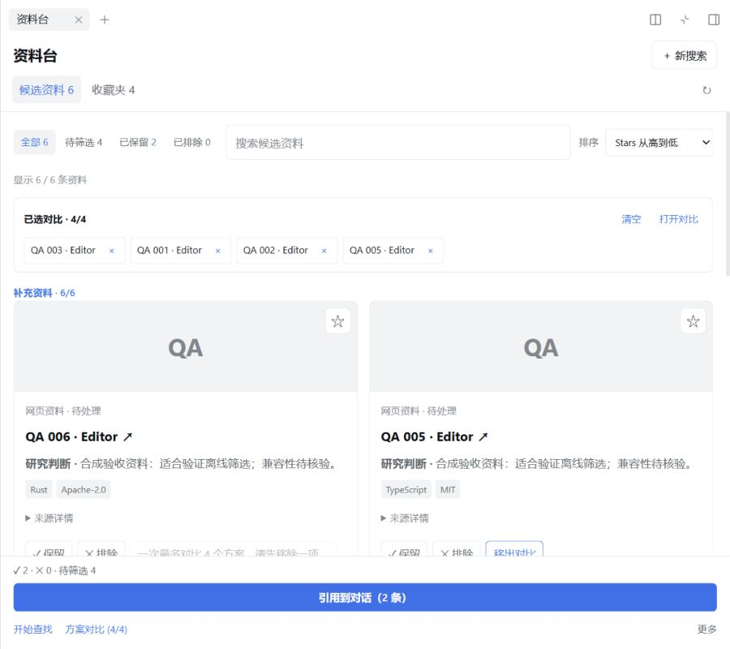

# 0.4.0: less friction in the screening flow

> [中文（默认）](2026-10-23-workflow-0.4.0.md) | English

After seeing the proposed four areas, the user delegated prioritization and asked to reduce friction. This iteration implements the existing-flow improvements from the [review](../research/2026-10-23-next-iteration-review.en.md). Delivery is a local preview package, without a 0.4.0 GitHub Release or production installation.

## Changes

- Shared candidate/favorite matching includes existing title, URL, note, snippet, description, language, license and topics; candidates also match reasons. Space-separated terms must all match. This is local filtering.
- Original order remains default; candidates sort within rounds by stars, code push or title. Unknown values follow valid values, zero remains valid and ties are stable. Favorites retain independent query/sort preferences.
- Comparison exposes up to four removable names, clear/open actions and selection order. Full unselected cards explain the limit locally. Keyboard removal restores neighboring focus, with a result/heading fallback and guards against stealing later focus.
- One undo restores the previous verdict/reason for the latest confirmed local choice. Reason autosaves do not create separate history. Undo uses the existing write queue, locks current-topic editing/referencing while pending and permits retry on failure. Later edits, observed conflicts, navigation, readonly state and clearing expire old undo. It is neither atomic across windows nor persistent across restarts.
- Research judgment requests cover task fit and material uncertainty; description stays an introduction. License/archive data is supplied only when found. Explicit user counts/lists override defaults, without padding with related products/dependencies/docs. No extra product model calls, tools or verification service were introduced.
- An initially unnamed active topic resolves to its real setId before editing becomes available. Same-session legacy drafts are copied only if no canonical draft exists, preserving originals. Composer/history entry now share query/sort/comparison state. Initial unresolved opening adds one ID-based read, then retains the target; idle scheduling is unchanged.

Exact DSH 0.2.1-rc.2 and Cordis 4.0.5 peers remain. No new dependency, lock graph, upstream or production change.

## Verification

The full suite passed **94/94**. New metadata/sort/order/undo/legacy regressions failed first. The [real React DOM and domain-operation probe](../research/probes/2026-10-23-client-interactions.mjs) passed **6/6**, using existing sandbox happy-dom tooling through `SOURCEDECK_DOM_RUNTIME`, without a product dependency. It covers undo edit locking, stale-owner completion, prior verdict/reason, undefined reason, neighboring focus and same-topic entry retention.

Independent review's undo input-overwrite and stale-owner findings were reproduced and fixed. Host-discovered duplicate focus callbacks and active/setId draft splitting also received failing regressions before fixes. Final focused review found no remaining concrete issues. Build passed with existing npm configuration warnings; packaging contains 53 files and no source/tests/docs/runtime caches.

The delivery package was installed through the official script. Installed Host/Client JS, manifest and bilingual READMEs match local bytes. Official built-ins stayed as configured; SourceDeck is the only extra profile dependency. Fixtures live inside the project sandbox and are explicitly synthetic.

| Final RC Host checks | Result |
|---|---|
| Multi-term metadata search | 6/24/200 fixtures matched 3/12/100; the saved QA source was found |
| Stars sorting | QA 024 / QA 200 lead the respective lists; zero and unknown remain distinct |
| Cross-entry retention | Composer entry → leave → historical card preserves `TypeScript MIT`, three matches, stars sort and two selections in order |
| Comparison | Limit, removal/clear, column order, Enter removal and neighboring focus passed |
| Light Chinese / dark English, results and four-source comparison | Actual widths 319/419/639/899px; no page overflow; vertical dimensions below 620px, tables above, five column headers retained |
| Fixed area | At 420×800, panel height 762px; header/nav/footer with undo 252.58px, **33.15%**, below the 35% target |
| Reference | A kept source in the 200-item set inserted SourceDeck · 1, preserving `Final delivery QA: retain this draft; do not send.` without sending |
| Console | No error attributed to the final instance URL; earlier restart connection errors are separate |

Local raw matrix: `sandbox/dsh-desktop/test-workspaces/dsh-source-deck/layout-0.4.0-delivery.json`. Runtime/auth logs are not committed. Filtered undo passed on the preceding same-version candidate and final component logic; the last code change was entry normalization, after which the complete presentation matrix and entry continuity were repeated as above.

[Narrow light](../assets/screenshots/source-deck-0.4.0-light.png) · [Dark English](../assets/screenshots/source-deck-0.4.0-dark.png). Screenshots use synthetic QA content.

## Model evidence and limits

Two normal managed research rounds were tested. The first requested only Zotero Connector and Obsidian Web Clipper but returned six sources. After resolving conflicting default-count guidance, the same request returned the two specified official repositories with use/limitation notes and metadata links. This establishes that sample's count/scope behavior, not general accuracy or independent fact verification. Stars, licensing, limitations and timestamps were not individually audited; generated lookup timestamps are not Host measurements.

Three fixture sessions were also activated by posting `/deck` through `session/prompt`. That API treated it as ordinary model text rather than the client slash command, so three parent model requests ran and were then individually cancelled. They are excluded from research-quality evidence. Later UI actions used existing entry controls; no production accounts/configuration were imported.

Native Electron 125% zoom, real IME/attachment combinations, screen-reader speech and human observation remain incomplete. Full-minute/history-scale performance matrices were not repeated, and no speedup is claimed.

## Delivery

`E:/DSH-Desktop-Plugin-Dev/dsh-source-deck/dsh-source-deck-0.4.0.tgz`: **187148 bytes / 53 files**.

- Package SHA256: `505B93611204D654BCAAB98C4637F09B785797F66B99EC1E305F6882B7014BAB`.
- Host JS: `03F7D5C6E84AC96E44DDA7E4AF861680ED17198B75C01C47CD28265BB3A47105`.
- Client JS: `E1F656BA57DC38D358243B7093C34BBCAFB511A4B8EFDB136AB1D2FAB86BCC85`.

Earlier candidate packages are not deliverables. Chinese/light settings and default browser viewport were restored; temporary pages closed. Only verified sandbox main PID 34336 was stopped; live lease is `occupied=false`. Source branch: `feat/workflow-0.4.0`; synchronization follows final Git verification. No automatic Release publication or production installation.
